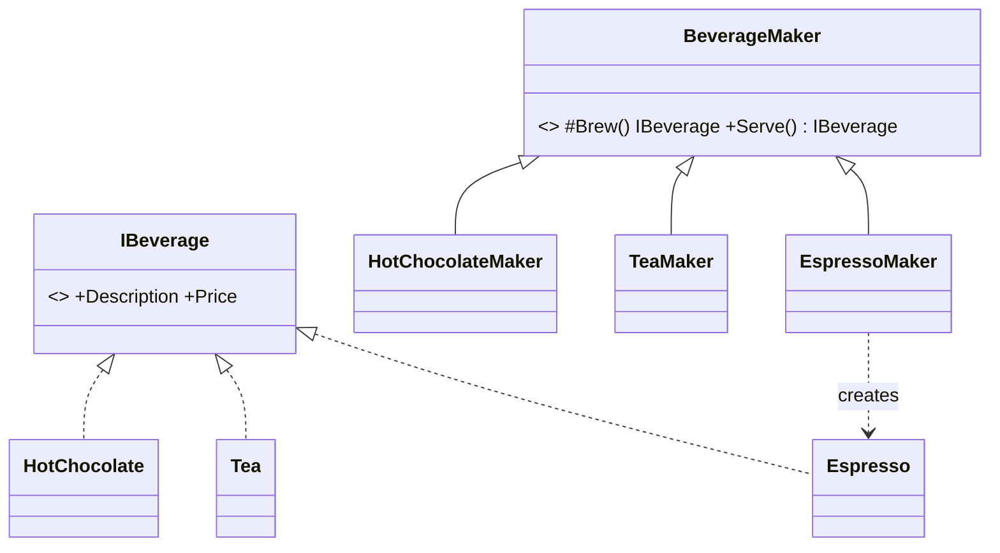
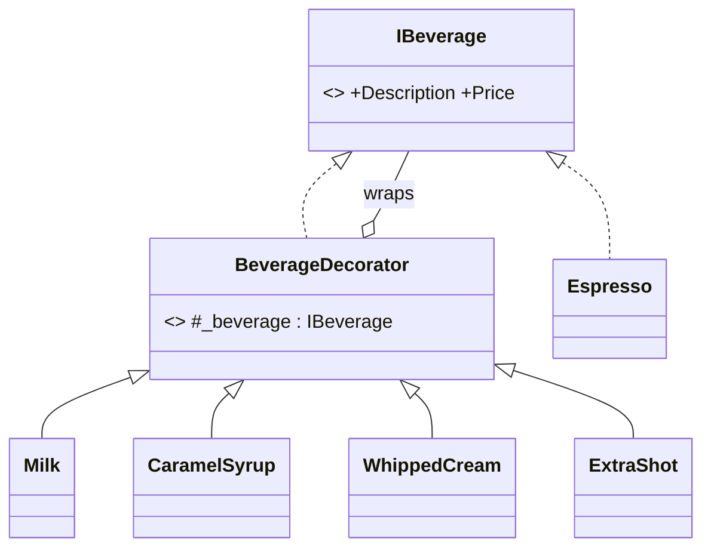
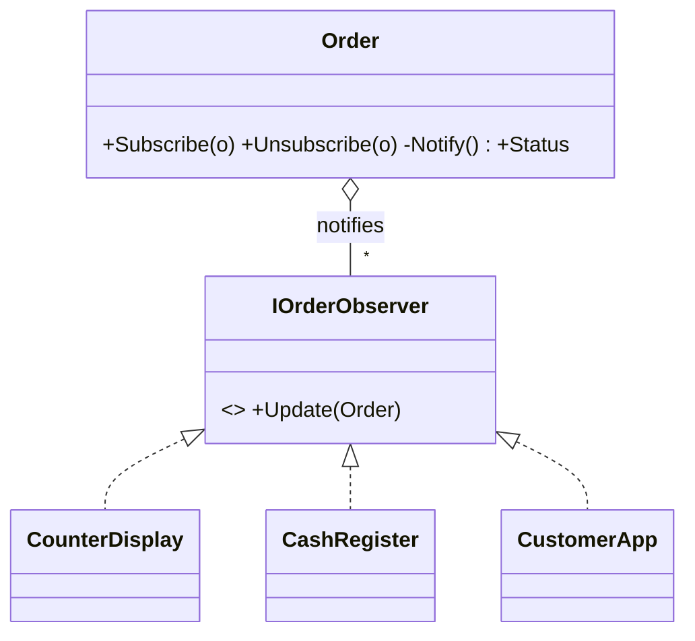

# Coffee Shop Ordering System – three design patterns

A simple C# console application that demonstrates one pattern from each GoF category
on **a single shared example** (ordering in a coffee shop):

| Category    | Pattern            | What it does in the project                                   | Folder        |
|-------------|--------------------|---------------------------------------------------------------|---------------|
| Creational  | **Factory Method** | prepares the base beverage (espresso, tea, hot chocolate)      | `Creational/` |
| Structural  | **Decorator**      | adds extras (milk, syrup, cream, shot) at runtime              | `Structural/` |
| Behavioral  | **Observer**       | notifies the display, register and customer app about the order status | `Behavioral/` |

The three patterns build on each other: the **factory method** prepares the beverage → the
**decorators** add extras → the finished beverage becomes an **order**, whose status changes
are pushed to the **observers**.

## Running

Requires the [.NET 8 SDK](https://dotnet.microsoft.com/download) (or Visual Studio 2022).

```bash
cd CoffeeShopPatterns
dotnet run              # runs straight through
dotnet run -- --step    # waits for Enter after each part – for live demos
```

In Visual Studio: *File → Open → Project/Solution* → `CoffeeShopPatterns.csproj`, then F5.

## 1. Factory Method

**Intent:** define an interface for creating an object, but let subclasses decide which class to instantiate.



- `BeverageMaker` = *Creator*, `Brew()` = *FactoryMethod*, `IBeverage` = *Product*
- The client calls `maker.Serve()` instead of `new Espresso()` → it does not depend on concrete classes.
- New beverage: one new `IBeverage` + one new `...Maker` class; existing code stays unchanged (**open/closed**).

## 2. Decorator

**Intent:** attach additional responsibilities to an object dynamically, without subclassing.



```csharp
IBeverage latte = new ExtraShot(new CaramelSyrup(new Milk(new Espresso())));
// "Espresso + milk + caramel syrup + extra shot" – 1240 HUF
```

- A decorator implements the same interface as the object it wraps → transparent to the client.
- 3 beverages × 4 optional extras would need 3 · 2⁴ = **48 classes** with inheritance; with decorators, **7**.
- Downside: many small objects, and removing a decorator from the middle of the chain is awkward.

## 3. Observer

**Intent:** a one-to-many dependency; when one object changes state, all its subscribers are notified automatically.



- `Order` = *Publisher*, `IOrderObserver` = *Subscriber*
- The order does not know who is watching or what they do – it just loops over the list and calls `Update`.
- Each observer reacts differently: the display shows everything, the app only reacts to "Ready",
  the register records revenue on delivery and then **unsubscribes at runtime**.

## Project structure

```
CoffeeShopPatterns/
├── CoffeeShopPatterns.csproj
├── Program.cs                   – the demo (uses all three patterns)
├── Creational/
│   ├── Beverage.cs              – IBeverage + Espresso, Tea, HotChocolate
│   └── BeverageMaker.cs         – Factory Method
├── Structural/
│   └── BeverageDecorator.cs     – Decorator + Milk, CaramelSyrup, WhippedCream, ExtraShot
└── Behavioral/
    ├── Order.cs                 – Publisher + IOrderObserver
    └── Observers.cs             – CounterDisplay, CashRegister, CustomerApp
```
